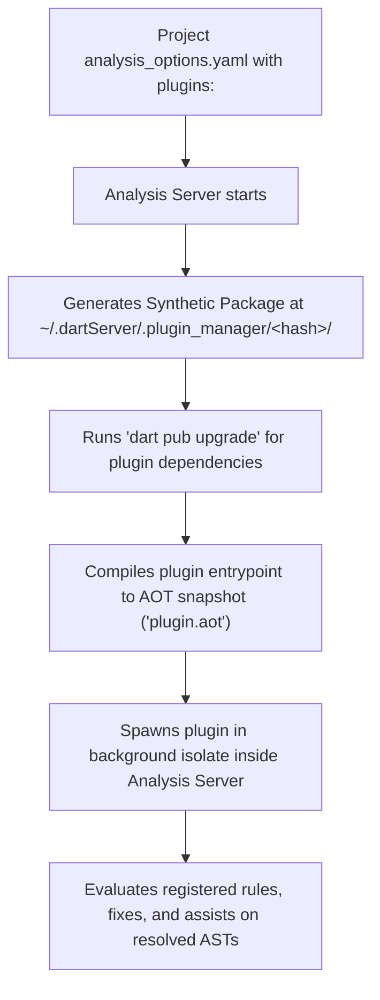

# Troubleshooting & Architecture Reference

This reference explains the runtime architecture of `analysis_server_plugin`, common pitfalls, cache management, debugging techniques, and comparisons with legacy systems.

---

## 1. How Modern Plugins Run Under the Hood

When a Dart Analysis Server session boots with a project specifying `plugins:` in `analysis_options.yaml`:



### Key Differences from Other Approaches

| Feature | Modern `analysis_server_plugin` (Dart 3.10+) | Community `custom_lint` | Legacy `analyzer_plugin` Protocol (Pre-3.10) |
| :--- | :--- | :--- | :--- |
| **Origin** | Official first-party Dart SDK | Third-party community package | Legacy Dart SDK plugin protocol (deprecated) |
| **Execution** | Compiled AOT snapshot in a separate isolate | Separate process via `custom_lint_builder` | Separate process via JSON-RPC protocol |
| **Activation** | Top-level `plugins:` in `analysis_options.yaml` | `custom_lint` in `pubspec.yaml` + `analysis_options.yaml` | `analyzer: plugins: [...]` (deprecated) |
| **CLI Support** | Native `dart analyze` and `flutter analyze` | Requires separate `dart run custom_lint` | Partial/fragile CLI support |
| **Suppression** | `// ignore: <plugin_name>/<rule_name>` | `// ignore: <rule_name>` | Inconsistent |

> [!NOTE]
> While the **legacy `analyzer_plugin` execution protocol** (`analyzer: plugins:` in `analysis_options.yaml`) is deprecated, `package:analyzer_plugin` still provides shared utility types—such as `ChangeBuilder`, `FixKind`, `AssistKind`, and `range`—that are actively imported when writing Quick Fixes and Assists in `analysis_server_plugin`.

---

## 2. Common Pitfalls & Solutions

### Issue 1: Edits to plugin code are not reflected in the IDE
- **Why**: The analysis server caches the compiled `plugin.aot` snapshot inside `~/.dartServer/.plugin_manager/<hash>/`.
- **Solution**:
  1. Restart the Dart Analysis Server:
     - **VS Code**: `Cmd+Shift+P` -> `Dart: Restart Analysis Server`.
     - **Android Studio / IntelliJ**: Click the circular restart button in the **Dart Analysis** tool window.
  2. If changes still do not appear, clear the plugin manager cache:
     ```bash
     rm -rf ~/.dartServer/.plugin_manager
     ```
     Then restart the analysis server.

### Issue 2: `analysis_options.yaml` nesting error
- **Wrong (Legacy)**:
  ```yaml
  analyzer:
    plugins:
      - my_plugin
  ```
- **Correct (Modern Dart 3.10+)**:
  ```yaml
  plugins:
    my_plugin:
      path: ../my_plugin
  ```

### Issue 3: Analyzer version conflict when resolving plugins
- **Why**: Multiple enabled plugins (or a plugin with outdated constraints) are combined into a single synthetic package by the analysis server, which runs `dart pub upgrade`. If constraints are incompatible with the active Dart SDK's `analysis_server_plugin`, resolution fails.
- **Solution**:
  1. Keep your plugin in its own isolated package (separate from your app's `pubspec.yaml`).
  2. Use `dart pub add analysis_server_plugin analyzer analyzer_plugin` inside the plugin package so Pub selects versions compatible with your current Dart SDK.

### Issue 4: Debugging a plugin or investigating silent crashes
- **Why `print()` does not work**: Because plugins run inside a background isolate managed by the Analysis Server, `print()` output is not routed to your terminal or IDE console.
- **How to debug and view crashes**:
  1. **Check the Analyzer Diagnostics UI**:
     - In VS Code, run `Dart: Open Analyzer Diagnostics` from the Command Palette (`Cmd+Shift+P` / `Ctrl+Shift+P`).
     - Open the **Plugins** page to inspect active plugins and view stack traces if a plugin isolate crashed due to an unhandled exception.
  2. **Log to a local file during development**:
     As recommended in the official `writing_a_plugin.md` guide, write debug traces to a local file when troubleshooting rule or fix logic:
     ```dart
     import 'dart:io';

     void debugLog(String message) {
       File('/tmp/my_plugin_debug.log').writeAsStringSync(
         '[${DateTime.now().toIso8601String()}] $message\n',
         mode: FileMode.append,
       );
     }
     ```

---

## 3. Best Practices for Monorepos & Team Repos

When creating rules for an organization or monorepo:
1. **Place the plugin in a separate subpackage** (e.g., `tools/lint_plugin` or `packages/architecture_linter`).
2. **Do not add application dependencies to the plugin's `pubspec.yaml`**. Keep the plugin lean with only `analysis_server_plugin`, `analyzer`, `analyzer_plugin`, and testing packages.
3. In consumer packages or monorepo roots:
   ```yaml
   plugins:
     architecture_linter:
       path: tools/lint_plugin
   ```
4. If sharing across multiple repositories before publishing to `pub.dev`, reference the plugin via Git:
   ```yaml
   plugins:
     architecture_linter:
       git:
         url: https://github.com/my-org/dart-tools.git
         path: packages/architecture_linter
         ref: v1.0.0
   ```
